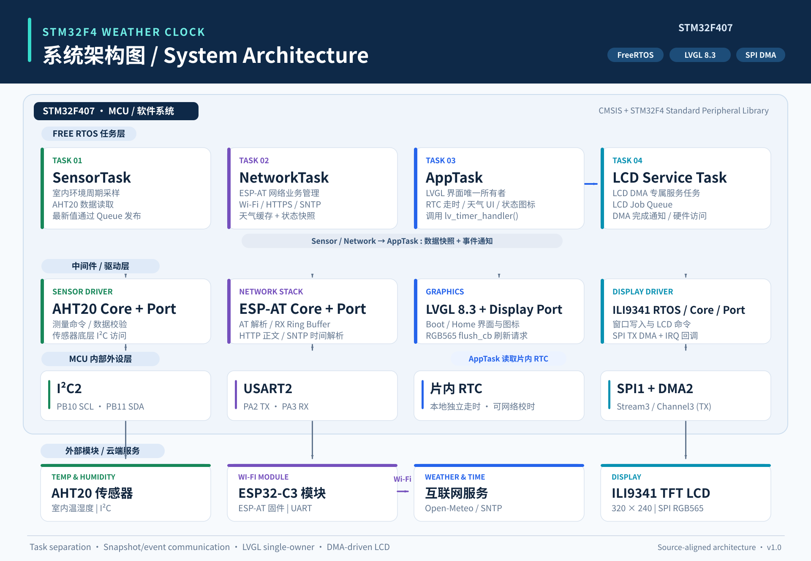

# STM32F4 Weather Clock | 基于 STM32F407 的天气时钟

基于 **STM32F407 + FreeRTOS + LVGL 8.3 + ILI9341 + ESP32-C3 + AHT20** 的嵌入式天气时钟工程。
提供 RTC 实时时钟、室内温湿度、Wi-Fi 天气查询、网络校时及 320×240 TFT 图形界面。

> **说明**：本仓库是从 Keil MDK-ARM 工程整理的可再构建源码；不包含原作者的 Wi-Fi 凭据和编译生成物。首次编译前须先创建自己的本地 Wi-Fi 配置。请根据所用开发板核对引脚与供电。仓库发布前请补充自己的项目许可证，并审核第三方代码的许可要求。

## 主要功能

- **本地时钟**：STM32 RTC 负责离线计时；ESP32-C3 通过 SNTP 网络校时。
- **图形界面**：LVGL 8.3.11、320×240 横屏、RGB565、卡片式主页面和开机界面。
- **LCD 驱动**：ILI9341，SPI1 TX + DMA2 Stream3，FreeRTOS LCD 服务任务负责写屏。
- **室内数据**：AHT20 温度与相对湿度，I2C2 接口。
- **室外天气**：ESP-AT + HTTPS 查询 Open-Meteo，包含温度、湿度、天气代码、风速、昼夜状态。
- **状态显示**：区分 Wi-Fi、天气缓存和 RTC 网络校时状态。
- **异常处理**：网络启动重试、离线本地走时、天气缓存回退等逻辑。

## 系统架构




```text
AppTask / LVGL UI ────────────────┐
     │                           │
     │ lv_timer_handler()        │
     ▼                           ▼
 LVGL flush_cb           事件通知 / 快照数据
     │                           ▲
     ▼                           │
LCD Service Task        SensorTask / NetworkTask
     │                       │             │
     ▼                       ▼             ▼
ILI9341 Core/Port      AHT20 (I2C2)   ESP32-C3 (USART2)
     │                                     │
     ▼                                     ├─ Wi-Fi / HTTPS
SPI1 TX DMA2 Stream3                      └─ SNTP → STM32 RTC
     │
 ILI9341 320×240
```

**线程与资源所有权**：AppTask 管理 LVGL 对象并调用 `lv_timer_handler()`；LCD Service Task 管理 LCD 硬件访问；NetworkTask 是 ESP-AT 业务流程的主要所有者。避免其他任务直接调用 LVGL API。

## 目录结构

```text
├── app/                    # AppTask、NetworkTask、SensorTask、页面与图标
│   ├── app.c
│   ├── weather_lvgl_ui.c
│   ├── weather_icons.c
│   ├── network_task.c
│   └── wifi_credentials.example.h  # 仅示例；真正的配置文件不提交
├── driver/
│   ├── ILI9341/            # LCD Port/Core/GFX/FreeRTOS/资源
│   ├── LVGL/               # LVGL 屏幕适配（flush 回调）
│   ├── esp_at/             # AT 协议及 USART 底层
│   ├── aht20/              # 传感器驱动
│   ├── rtc/                # RTC 驱动
│   ├── console/            # 调试日志
│   ├── key/                # 按键
│   └── led/                # LED
├── firmware/               # STM32F4 CMSIS、标准外设库
├── third_lib/
│   ├── freertos/           # FreeRTOS Kernel V10.4.3 LTS Patch 3
│   ├── lvgl/               # LVGL v8.3.11（保留本项目所需源码）
│   └── lv_conf.h           # LVGL 配置
├── mdk/
│   └── stm32f407.uvprojx   # Keil uVision 工程文件
├── .gitignore
└── THIRD_PARTY_NOTICES.md
```

## 硬件与接口（以本仓库源码为准）

| 模块 | STM32F407 连接 | 备注 |
|---|---|---|
| ILI9341 SCK / MOSI | PA5 / PA7 | SPI1 |
| ILI9341 CS / DC / BL | PA4 / PC5 / PB1 | 详见 `ili9341_port.c` |
| ILI9341 数据 DMA | DMA2 Stream3 Channel3 | SPI1 TX |
| AHT20 SCL / SDA | PB10 / PB11 | I2C2，100 kHz |
| ESP32-C3 TX / RX | MCU PA3 / PA2 | MCU USART2 RX / TX，115200 baud |

> 请核对开发板 MCU 的封装、LED/按键、LCD RST、供电、电平以及 USART 连接。代码中的注释与宏定义可能存在历史差异，最终以实际硬件初始化代码和原理图为准。

## 环境依赖

- **Keil MDK-ARM 5 / uVision5**，原项目使用 **ARM Compiler 5.06**。
- STM32F4 对应的 Keil Device Family Pack 和烧录调试器驱动。
- 包含在仓库内的 STM32F4 标准外设库、FreeRTOS 和 LVGL 源码。
- 刷入兼容 ESP-AT 的 ESP32-C3 固件，ESP32-C3 与 MCU 串口参数一致。
- 可用的 **2.4 GHz** Wi-Fi；HTTPS 天气服务需要模块联网。

## 第一次编译（重要）

1. **从公开示例生成私有 Wi-Fi 配置：**

   Windows CMD（工程根目录）：
   ```bat
   copy app\wifi_credentials.example.h app\wifi_credentials.h
   ```
   用编辑器打开 `app/wifi_credentials.h`，填写自己的 `WEATHER_WIFI_SSID` 和 `WEATHER_WIFI_PASSWORD`。千万不要将这个文件提交到 Git。

2. 用 Keil uVision5 打开 `mdk/stm32f407.uvprojx`。
3. 检查 MCU、Pack、ARM Compiler 5 配置与烧录设置。
4. 执行 **Rebuild all target files**，然后下载至开发板。
5. 使用串口日志检查 ESP-AT 握手、Wi-Fi、SNTP、HTTP、AHT20 和 LVGL 刷新情况。

**重要**：缺少 `app/wifi_credentials.h` 时，`network_task.c` 无法编译。这是刻意设计，目的是避免将真实凭据公开。不要用原始上传包中的硬编码配置覆盖它。

## 运行流程

```text
上电初始化 → RTC/LCD/FreeRTOS → LVGL 开机页 → 主界面
            ├─ SensorTask: AHT20 周期采样
            ├─ AppTask: RTC 持续更新，LVGL 定时重绘
            ├─ NetworkTask: AT → Wi-Fi → SNTP → 天气 HTTP
            └─ LCD Service: 接收刷新请求，DMA 传输至 ILI9341
```

天气服务目前采用 **秦皇岛** 的固定经纬度；换城市时修改 `app/network_task.c` 中 Open-Meteo URL 的坐标。请自行确认天气服务的使用条款和调用额度。

## 维护建议 / Known limitations

- UI 与网络初始化已做基础容错，但真实硬件连接、供电、AT 固件版本可能影响稳定性。
- `AT+CWJAP` 命令使用字符串拼接，Wi-Fi 名称或密码带 `"`、`\` 等特殊字符时需进一步实现 ESP-AT 参数转义。
- Keil ARMCC5 工程配置不代表已经在 GCC 或 STM32CubeIDE 下验证。
- `LVGL` 与 `FreeRTOS` 的三方版权不属于此项目作者。转载、修改时必须保留其版权声明。
- 欢迎在 Issues 中反馈编译错误，并附编译器版本、硬件连接、固件日志（先删除隐私信息）。

## 第三方组件与许可证

请阅读 [THIRD_PARTY_NOTICES.md](THIRD_PARTY_NOTICES.md)。**项目本身的 LICENSE 由仓库所有者选定后再添加**；未添加前，虽然源码可见，却不能视为已经授予全部开源再使用权限。
